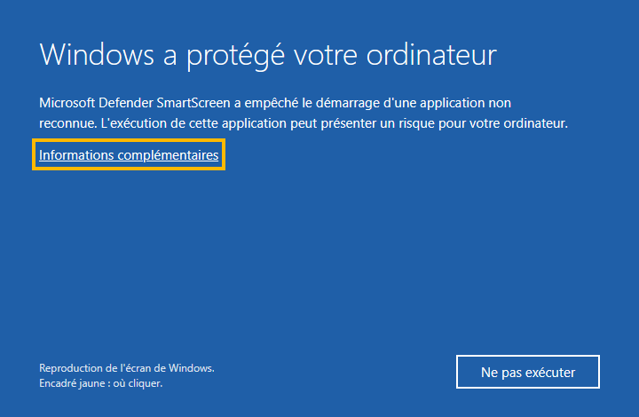
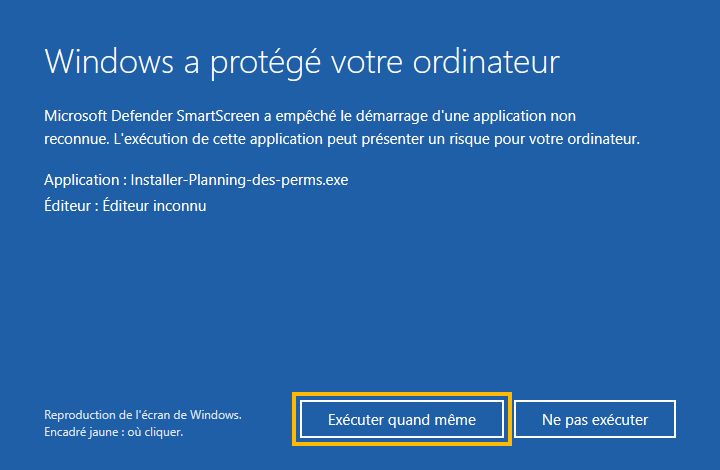
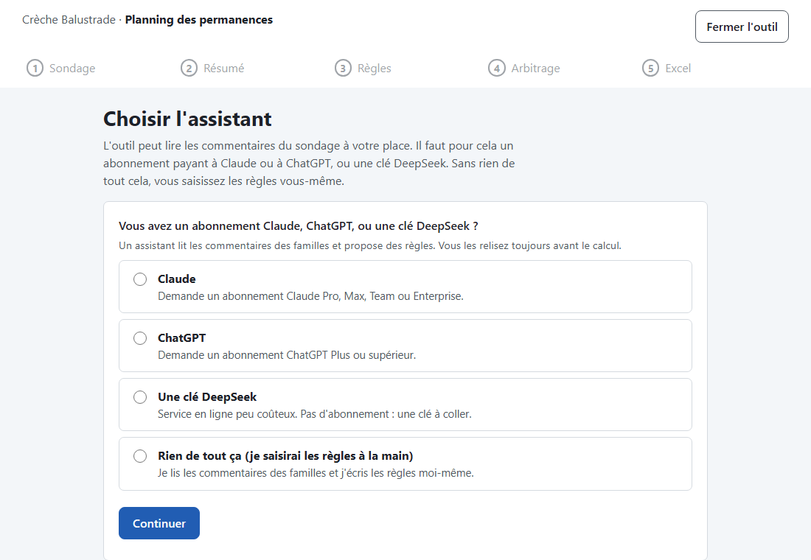
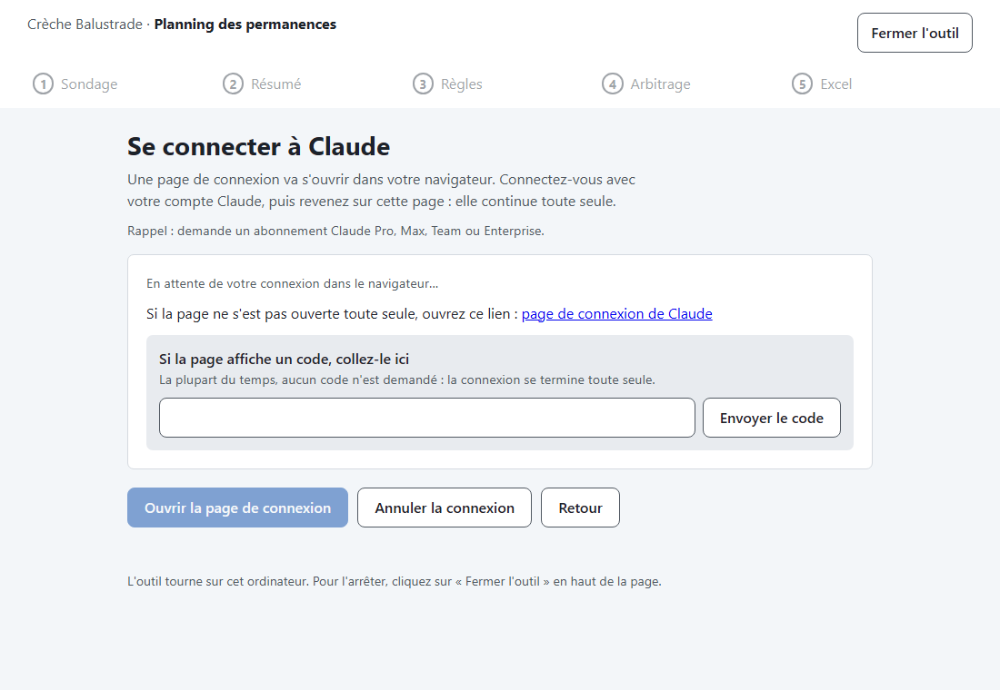
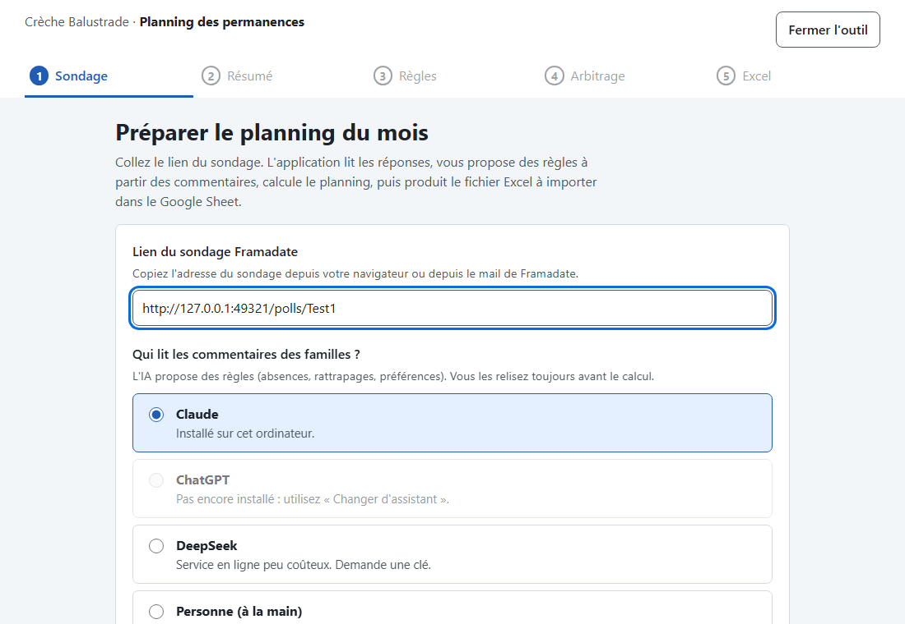

# Guide pas à pas

Pour installer et lancer le planning des perms sur un ordinateur Windows. Comptez dix minutes la première fois.

## 1. Télécharger

Sur la [page de l'outil](https://github.com/yannick-bottino/planning-des-perms), cliquez sur le bouton **Télécharger pour Windows**. Le fichier `Installer-Planning-des-perms.exe` arrive dans votre dossier Téléchargements.

## 2. Passer l'avertissement de Windows

L'installeur n'a pas de signature payante, donc Windows se méfie. C'est normal pour un outil bénévole.

1. Cliquez sur **Informations complémentaires** (le lien sous le texte).
2. Un bouton **Exécuter quand même** apparaît : cliquez dessus.

## 3. Installer

Suivez les écrans de l'installeur. Aucun mot de passe administrateur n'est demandé. À la fin, laissez cochée la case **Lancer le planning des perms**.

Une icône **Planning des perms** apparaît sur le bureau et dans le menu Démarrer.

## 4. Premier lancement : choisir l'assistant

L'outil s'ouvre dans Chrome. Il demande d'abord : « Vous avez un abonnement Claude, ChatGPT, ou une clé DeepSeek ? »

Choisissez ce que vous avez. Claude et ChatGPT demandent un abonnement payant. Sans abonnement, choisissez **Rien de tout ça** : vous saisirez les règles à la main.

## 5. Installer et connecter l'assistant

Pour Claude ou ChatGPT, l'outil installe l'assistant (quelques minutes), puis ouvre la page de connexion de votre compte dans le navigateur.

1. Connectez-vous avec votre compte habituel, puis acceptez.
2. Revenez dans l'onglet du planning : il passe seul à la suite.
3. Si la page de connexion affiche un code, copiez-le et collez-le dans le champ prévu de l'outil.

Pour ChatGPT, une autre méthode existe si la page ne s'ouvre pas : un code à usage unique. Il faut d'abord l'autoriser dans les réglages de sécurité de ChatGPT ; l'outil explique où.

## 6. Ensuite

Collez le lien du sondage Framadate et suivez les cinq étapes jusqu'à l'Excel.

## Fermer, relancer

- **Fermer** : bouton **Fermer l'outil** en haut de la page.
- **Relancer** : icône **Planning des perms** sur le bureau.
- Si vous fermez seulement l'onglet, l'outil s'arrête seul après quelques minutes.

## En cas de souci

- L'outil ne s'ouvre pas : attendez une minute, puis cliquez de nouveau sur l'icône.
- L'installation de l'assistant échoue : vérifiez la connexion internet, puis réessayez.
- Un journal technique se trouve dans `%LOCALAPPDATA%\balustrade-planning\journal.txt`. Il ne contient ni clé ni commentaire du sondage : vous pouvez l'envoyer à la personne qui maintient l'outil.
